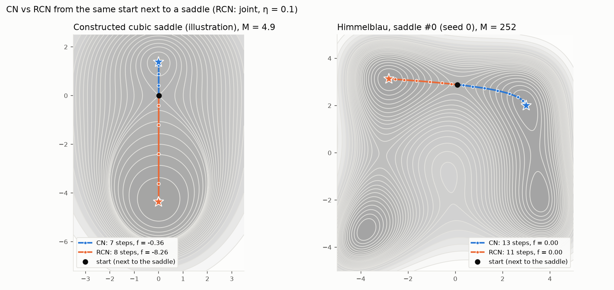

# Reflected Cubic Newton

**Cubic-regularized Newton with sign-reflected negative-curvature steps.**

Reflected Cubic Newton (RCN) is a small modification of the cubic-regularized Newton method (CN). After computing the usual CN step, RCN builds a second candidate step in which the components along negative-curvature directions have their signs flipped. It then evaluates the objective at both candidates and keeps the one with the lower value. With the default settings, this costs at most one extra function evaluation per iteration and no extra derivatives.



*Left: a two-dimensional function constructed to show the mechanism (an illustration, not evidence). Right: Himmelblau's function. Both methods start from the same point with the same M; RCN reflects the first step.*

> Research prototype, October 2026. Only small, dense problems have been tested (up to n = 141 variables); the dense eigendecomposition limits the method to a few thousand variables. Please read [Limitations](#limitations) before relying on the numbers below.

## At a glance

- **What it does.** Near a saddle point, RCN chooses the sign of the escape step by comparing true function values, instead of leaving the choice to a tiny gradient component.
- **What it guarantees.** Every iteration decreases the objective at least as much as a CN step from the same point, and, with M ≥ L, RCN keeps CN's iteration complexity at the CN trial points ([Theorem 1](docs/proofs.md#theorem-1-monotonicity-and-complexity-at-the-cn-trial-points)). From an exact saddle, the first step is provably at least as good as CN's and strictly better when CN picks the unfavourable sign ([Theorem 2](docs/proofs.md#theorem-2-first-step-from-an-exact-strict-saddle)).
- **What it achieves in experiments.** On the saddle_tensor benchmark, whose saddles have third-order asymmetry, the decrease over the first three iterations is 16–43% larger on average than CN's at the same M (M = 3×L̂; the medians are 0–7%, because the gain comes from about half of the problems). This costs 3.5–7% extra function evaluations and less than 2.5% extra run time.
- **Where it does not help.** On problems whose saddles are symmetric (matrix factorization, phase retrieval, small tanh networks), the difference is negligible. It does not reliably reduce the total number of iterations, and it does not find better local minima.

## Key terms

| Term | Meaning |
| --- | --- |
| CN | Cubic-regularized Newton method (Nesterov & Polyak, 2006). Each step minimizes a quadratic model of f plus a cubic penalty (M/6)‖s‖³. |
| RCN | Reflected Cubic Newton, the method in this repository. |
| ARC | Adaptive Regularization with Cubics (Cartis, Gould & Toint, 2011): CN in which M is adjusted at every iteration. |
| M | Regularization parameter of the cubic penalty. Larger M gives shorter, more cautious steps. |
| L, L̂ | Lipschitz constant of the Hessian, and its estimate from random samples (used to set M in the benchmarks). |
| g, H | Gradient ∇f(x) and Hessian ∇²f(x) at the current point. |
| λ₁, v | Smallest eigenvalue of H and its unit eigenvector. A strict saddle has λ₁ < 0. |
| SOSP | Second-order stationary point: a point with a small gradient and no strongly negative curvature. |
| D(k) | Decrease after k iterations, f(x₀) − f(x_k). |
| CI | Confidence interval. All intervals below are 95% bootstrap intervals. |

## Idea

The cubic penalty of the CN model, (M/6)‖s‖³, is an *even* function: its value does not change when the step s is replaced by −s. The true third-order term of the Taylor expansion, (1/6)∇³f(x)[s, s, s], is an *odd* function: it changes sign.

Therefore, near a strict saddle, the CN model gives almost the same value to a step s along a negative-curvature direction and to its mirror image −s, even though the true function values at x + s and x − s can differ considerably. CN chooses between these two steps according to a tiny gradient component. RCN makes the same choice by comparing the actual function values.

## Algorithm

Each iteration uses the gradient g, the Hessian H = QΛQᵀ and a fixed M > 0.

1. **CN step.** Minimize the model m(s) = gᵀs + ½sᵀHs + (M/6)‖s‖³ exactly in the eigenbasis of H (bisection on the shift μ, including the so-called hard case).
2. **Reflected candidate.** Let N = {i : λᵢ < −δ} be the negative-curvature directions. The reflected candidate s′ flips the sign of the components of s in N. Only the linear term of the model changes, by

   ```text
   Δ_ref = m(s′) − m(s) = 2 Σ_{i∈N} |g̃ᵢ s̃ᵢ| ≥ 0,
   ```

   where g̃ and s̃ are g and s in the eigenbasis.
3. **Activation test.** Evaluate s′ only if η > 0, N is not empty and Δ_ref ≤ η·(−m(s)) (default η = 0.1). Far from a saddle the gradient is large, Δ_ref grows, and the test skips the extra evaluation.
4. **Selection.** Keep whichever of x + s and x + s′ has the lower function value (`mode="joint"`). Alternatively, flip the components in N one at a time (`mode="greedy"`, up to |N| extra evaluations).

Because the CN step is always one of the candidates, every RCN iterate is at least as good as the CN step from the same point.

```python
def rcn_step(f, x, M, eta=0.1):
    g, H = grad(f)(x), hessian(f)(x)
    lam, Q = eigh(H)
    gt = Q.T @ g
    st = solve_cubic(lam, gt, M)                       # exact global minimizer of m
    best = x + Q @ st
    N = lam < -delta(lam)
    if eta > 0 and N.any():
        d_ref = 2 * abs(gt[N] * st[N]).sum()
        if d_ref <= eta * (-model(lam, gt, st, M)):
            st2 = st.clone(); st2[N] *= -1             # reflect the negative-curvature part
            cand = x + Q @ st2
            if f(cand) < f(best):
                best = cand
    return best
```

## What is claimed

- **Monotonicity, and CN's complexity at the CN trial points.** Each iterate is no worse than the CN trial point y_k = x_k + s_k. Hence every iteration decreases f at least as much as CN would from x_k. With M ≥ L, the standard CN argument then gives the O(ε^(−3/2)) iteration bound for the trial points y_k. When a reflection is accepted, the guarantee applies to y_k, not to the next iterate x_{k+1} ([Theorem 1](docs/proofs.md#theorem-1-monotonicity-and-complexity-at-the-cn-trial-points)).
- **A larger first step at strict saddles.** Start from an exact saddle (g = 0) where λ₁ is a simple eigenvalue, and let a = (2/3)|∇³f[v, v, v]|/M. The first step then decreases f by 2|λ₁|³/M² · (1 + a) with RCN, and by 2|λ₁|³/M² · (1 + a) or 2|λ₁|³/M² · (1 − a) with CN, depending on which sign CN happens to pick. This is exact for cubic polynomials. For general f it holds up to an error of (2/3)L₃λ₁⁴/M⁴, where L₃ is the Lipschitz constant of the third derivative ([Theorem 2](docs/proofs.md#theorem-2-first-step-from-an-exact-strict-saddle)). Experiment E6 confirms the exact case (see [Results](#results)).

**Not claimed:**

- **Better local minima.** On saddle_tensor, RCN ends at a lower final value than CN in 14–31% of runs and at a higher one in 21–31% (counting differences of at least 1% of CN's total decrease). It ends at a different point in about half of the runs.
- **Fewer iterations in general.** Where the 95% CI of the paired difference in iterations contains 0, no saving is claimed.
- **Any effect at symmetric saddles.** Some saddles are fixed points of a sign symmetry. For matrix factorization and phase retrieval, f(x) = f(−x). For a tanh network, f does not change when the input weights, bias and output weight of one hidden unit are flipped together. On these problems, ∇³f[v, v, v] = 0 along the negative-curvature eigenvectors. Reflections occasionally win by tiny margins, but in no run does the decrease after 1, 3 or 5 iterations change by more than 0.6%.
- **Being faster than ARC.** Adapting M at every iteration (ARC) improves on fixed-M CN by much more than the reflection does. The reflection is an add-on that can be combined with either method (E8).
- **Large-scale use.** Every iteration requires a dense eigendecomposition.

## Results

**Near saddles with third-order asymmetry, RCN decreases f more than CN does over the first few iterations at the same M, at a cost of 3.5–10% extra function evaluations and less than 2.5% extra run time. On problems with symmetric saddles, the difference is negligible (below 0.6%).** The gain becomes smaller as M or the dimension n grows, and a similar gain remains when the reflection is added to ARC (E8).

The main measure is the paired ratio D_RCN(k) / D_CN(k). For each pair, CN and RCN solve the same problem from the same initial point x₀ with the same value of M (100 random instances per row; RCN in `joint` mode with η = 0.1). A ratio above 1 means that RCN decreased f more than CN did. This measure focuses on the first few iterations. After that, the two methods may move towards different minima, and their values are no longer directly comparable. Theorem 2 also describes this early phase.

### Main comparison (E2, M = 3×L̂)

| Problem | D(1) ratio, mean [95% CI] | D(3) ratio, mean [95% CI] | D(3) ratio, median | Runs ≥1% better / worse at k = 3 | Extra function evaluations | Reached SOSP, CN / RCN |
| --- | --- | --- | --- | --- | --- | --- |
| saddle_tensor, n = 20, cubic 0.3 | 1.033 [1.024, 1.042] | 1.339 [1.226, 1.461] | 1.064 | 52% / 1% | 7.1% | 100% / 100% |
| saddle_tensor, n = 20, cubic 1 | 1.035 [1.025, 1.045] | 1.434 [1.280, 1.607] | 1.073 | 52% / 1% | 4.4% | 100% / 100% |
| saddle_tensor, n = 50, cubic 0.3 | 1.026 [1.020, 1.033] | 1.270 [1.196, 1.359] | 1.023 | 52% / 2% | 4.9% | 100% / 100% |
| saddle_tensor, n = 50, cubic 1 | 1.026 [1.020, 1.034] | 1.291 [1.210, 1.388] | 1.024 | 52% / 2% | 4.0% | 100% / 100% |
| saddle_tensor, n = 100, cubic 0.3 | 1.018 [1.012, 1.024] | 1.163 [1.104, 1.232] | 1.000 | 42% / 5% | 3.9% | 100% / 100% |
| saddle_tensor, n = 100, cubic 1 | 1.018 [1.012, 1.024] | 1.169 [1.109, 1.241] | 1.000 | 43% / 5% | 3.5% | 100% / 100% |
| Matrix factorization ‡ | 1.000 [1.000, 1.000] | 1.000 [1.000, 1.000] | 1.000 | 0% / 0% | 38.1% | 100% / 100% |
| Phase retrieval ‡ | 1.000 [1.000, 1.000] | 1.000 [1.000, 1.000] | 1.000 | 0% / 0% | 4.0% | 100% / 100% |
| Small tanh MLP ‡ | 1.000 [1.000, 1.000] | 1.000 [1.000, 1.000] | 1.000 | 0% / 0% | 2.8% | 0% / 0% |
| Himmelblau | 1.002 [1.002, 1.003] | 1.020 [1.015, 1.025] | 1.000 | 49% / 0% | 7.8% | 100% / 100% |
| Cubic saddle, 2-D † | 1.134 [1.106, 1.161] | 4.744 [3.956, 5.529] | 1.000 | 47% / 0% | 9.6% | 100% / 100% |

† Constructed to show the mechanism (the figure at the top); an illustration, not evidence.

‡ The saddle is a fixed point of a sign symmetry (see "Not claimed"), and ∇³f(0)[v, v, v] = 0 along every negative-curvature eigenvector (checked by automatic differentiation). Reflections were still accepted in some runs, because the initial point was slightly off the symmetric point. However, in every run, the values of D(1), D(3) and D(5) under RCN stayed within 0.6% of those under CN, and the final values differed by less than 0.5% of CN's total decrease. The MLP did not reach a second-order stationary point within 200 iterations with any method, because its landscape is nearly flat. The setting M = 1×L̂ was excluded for the MLP because CN itself increased f there, which shows that L̂ underestimated L.

With a smaller M = 1×L̂, the first-step gain on saddle_tensor was larger than at M = 3×L̂ (mean D(1) ratio 1.06–1.13 instead of 1.02–1.04), but 9–15% of problems then had a smaller decrease after three iterations than under CN. With a larger M = 10×L̂, the gain was smaller (1.005–1.010), and no problem became worse than under CN. The full results for all three values of M are in [`results/e2.csv`](results/e2.csv) and are plotted in [`e2_dk.png`](results/e2_dk.png) and [`e2_share.png`](results/e2_share.png). The same files include ARC and nc_pm; nc_pm is a simplified baseline written for this comparison and does not represent the method that inspired it.

### Iterations to a second-order stationary point (secondary measure; M = 3×L̂, 500 instances)

| Problem | CN, median iterations | RCN − CN, mean [95% CI] | Final f lower / higher than CN |
| --- | --- | --- | --- |
| saddle_tensor, n = 20, cubic 1 | 20 | +0.22 [−0.46, +0.90] | 23% / 24% |
| Matrix factorization ‡ | 8 | 0 | 0% / 0% |
| Phase retrieval ‡ | 18 | 0 | 0% / 0% |
| Small tanh MLP ‡ | 200 (limit) | 0 | 0% / 0% |
| Himmelblau | 11 | −0.47 [−0.55, −0.39] | 0% / 0% |
| Cubic saddle, 2-D † | 8 | +0.66 [+0.60, +0.73] | 51% / 0% |

No saving is claimed where the interval contains 0. "Lower / higher" counts runs whose final value differs from CN's by at least 1% of CN's total decrease f(x₀) − f(x_final). On the cubic saddle, RCN needs more iterations because it moves towards the deeper valley, which is farther away.

### Other experiments

**Combined with ARC (E8).** Adding the same reflected candidates to every ARC step (`method="rarc"`) preserves the early gain. Relative to plain ARC, the D(3) ratio is 1.11–1.90 on saddle_tensor (for all starting values M₀ and all n), 1.000 on the symmetric problems, and 1.00–1.02 on Himmelblau. The number of iterations does not change significantly. Theorem 1 assumes a fixed M and does not cover `rarc`. [`results/e8.csv`](results/e8.csv)

**Check of Theorem 2 (E6).** On saddle_tensor without the quartic term, one step from the exact saddle matches the closed-form prediction to a relative error of 4 × 10⁻¹⁵ in all 1,200 trials. In the 630 trials where CN picks the unfavourable sign, the ratio RCN / CN equals (1 + a)/(1 − a). [`e6_theorem2.png`](results/e6_theorem2.png)

**Cost (E3, single thread).** Share of run time spent on reflected candidates: 0.1–2.2% in `joint` mode and 0.2–10.3% in `greedy` mode (the larger value on the MLP, which has about 70 negative eigenvalues near the start). Each iteration is dominated by computing the Hessian and its eigendecomposition. [`e3_cost.png`](results/e3_cost.png)

**Threshold η (E4).** The decreases D(k) are identical for η = 0.1, 0.5, 1 and ∞ on every problem; only the number of wasted evaluations changes. This is why the default is η = 0.1. [`e4_eta.png`](results/e4_eta.png)

**Prototype check (E1).** The numbers from an earlier NumPy prototype are reproduced within sampling error on 1,000 problems. [`e1_table_repro.png`](results/e1_table_repro.png)

## Limitations

- **The effect decreases as M increases.** The gain scales with the ratio of the third-order asymmetry to M. With M = 10×L̂, the mean first-step gain on saddle_tensor is only 0.5–1%.
- **The effect decreases as the dimension increases.** At a fixed multiple of L̂, the gain at n = 100 is about half of that at n = 20.
- **Symmetric saddles gain nothing, and the activation test cannot filter them out.** Because Δ_ref ≈ 0 there, the reflected candidate is still evaluated. On matrix factorization this wastes about 5 function evaluations per run (2–3% of run time). A rule that stops after repeated exact ties would not help either: the reflected value differs from the CN value by a relative 1e-11 to 5e-2, because the start is not exactly at the symmetric point.
- **Heavy tails.** A minority of problems account for most of the mean gain; the medians of the per-problem ratio are 1.00–1.07. For this reason, the tables report both the mean and the median, together with the share of problems that changed by at least 1% in either direction.
- **Later iterations can be worse.** After the first step, RCN and CN follow different paths. With M = 1×L̂, 9–15% of saddle_tensor problems have a smaller decrease after three iterations under RCN.
- **`greedy` mode is expensive when there are many negative eigenvalues.** On the MLP (about 70 negative eigenvalues near the start), 90% of its function evaluations go to reflections, which is 10% of the run time. It outperforms `joint` only with η = ∞ and large cubic terms. Use the default `joint`.
- **Dense and small.** The eigendecomposition costs O(n³) per iteration; the largest problem tested has n = 141.
- **L̂ is an estimate.** M is set as a multiple of a sampled estimate of the Hessian Lipschitz constant. On the MLP, M = 1×L̂ was below the true constant (CN itself increased f), so that setting is excluded.

## Benchmarks

- **Problems.**
  - `saddle_tensor`: ½xᵀAx + (1/6)T[x, x, x] + (c/24)‖x‖⁴. A has n_neg eigenvalues drawn from −U(0.5, 1.5) and the rest from U(0.5, 2.0). T is a tensor of standard normal entries, averaged over the six index permutations and scaled by the "cubic size". c = 1, and the start is 10⁻⁶·N(0, I) away from the saddle at 0.
  - `matrix_factorization`: ¼‖UUᵀ − Y‖²_F with d = 20 and rank 2.
  - `phase_retrieval`: (1/4m) Σ((aᵢᵀx)² − yᵢ)² with n = 20 and m = 100.
  - `small_mlp`: a two-layer tanh network with 141 parameters, fitted to a random teacher network.
  - `test_functions`: Himmelblau's function (starting 10⁻⁶ away from one of its four saddles) and a constructed 2-D cubic saddle used for illustration only.
- **Regularization.** M ∈ {1, 3, 10} × L̂, where L̂ is the largest value of ‖∇²f(x) − ∇²f(y)‖₂ / ‖x − y‖ over 200 random pairs in a ball of radius R around the start. R is chosen for each instance so that the ball covers the first CN step at M = L̂, that is, R = 2|λ₁(x₀)|/L̂(R), solved by bisection. A fixed R = 1 made M far too small on matrix factorization.
- **Fairness.** All methods share the same exact subproblem solver, and CN and RCN always use the same M, starting point and random seed. Function evaluations count trial points only; gradients and Hessians are counted separately.
- **Baselines.**
  - `cn`: the Nesterov–Polyak method with fixed M.
  - `arc`: Cartis–Gould–Toint adaptive regularization (thresholds 0.1 / 0.9 on the ratio ρ of actual to predicted decrease; M is multiplied by 2 or 0.5).
  - `nc_pm`: a simplified negative-curvature method written for this comparison. It takes a step of length 2|λ₁|/M along ±v, with the sign chosen by two function values, when its predicted decrease is larger than that of a gradient step; otherwise it takes a gradient step with Armijo backtracking. **It is a simplified baseline and does not represent the performance of the method in the paper that inspired it.**

## Install

```bash
git clone https://github.com/ibaran1um/reflected-cubic-newton
cd reflected-cubic-newton
python -m venv .venv && . .venv/bin/activate        # Python 3.11+
pip install -e ".[dev]"                             # torch>=2.3, numpy, matplotlib, pyyaml; dev: pytest, scipy
pytest
```

## Usage

```python
import torch
from rcn import minimize

def f(x):                                           # 1-D float64 tensor -> scalar tensor, torch.func-traceable
    return 0.5 * x[0]**2 - 0.5 * x[1]**2 + x[1]**3 / 6 + (x @ x)**2 / 24

res = minimize(f, torch.tensor([2e-3, 1e-3], dtype=torch.float64),
               method="rcn",                        # "cn" | "rcn" | "arc" | "rarc" | "nc_pm"
               M=3.0, mode="joint", eta=0.1, eps_g=1e-8, max_iter=200)
res.x, res.status, res.history                      # final point, "sosp" | "max_iter", list of IterLog
```

`method="rarc"` is ARC with the reflected candidates added to every step. It is experimental; the guarantees in [docs/proofs.md](docs/proofs.md) are for fixed M.

## Reproduce

```bash
python benchmarks/run.py --config benchmarks/configs/e2.yaml   # also e1, e2_iters, e3, e4, e5, e8
python benchmarks/e6.py                                        # check of Theorem 2
python benchmarks/e7.py                                        # the figure at the top
python benchmarks/plot.py e1 e2 e3 e4 e5                       # figures from results/*.csv
```

Aggregated CSV files and figures are in `results/`. L̂ is cached in `results/raw/lhat_cache.json` after the first run. Computing it dominates the run time: about 1.5 hours for E2 with the default 8 worker processes × 2 PyTorch threads on a 16-thread CPU, followed by about 1 hour for the runs themselves.

## Related work

To my knowledge, as of October 2026 the same method has not been published: I found no prior work that reflects part of a cubic-regularized Newton step. The closest idea is choosing the sign of a negative-curvature direction ±q by comparing two function values; that idea applies to the curvature direction alone rather than to the CN step.

- Y. Nesterov, B. T. Polyak. [Cubic regularization of Newton method and its global performance](https://doi.org/10.1007/s10107-006-0706-8). Mathematical Programming 108(1):177–205, 2006. — The base CN method.
- C. Cartis, N. I. M. Gould, Ph. L. Toint. [Adaptive cubic regularisation methods for unconstrained optimization. Part I: motivation, convergence and numerical results](https://doi.org/10.1007/s10107-009-0286-5). Mathematical Programming 127(2):245–295, 2011. — The `arc` baseline.
- A. S. Berahas, R. Bollapragada, W. Dong. [Negative Curvature Methods with High-Probability Complexity Guarantees for Stochastic Nonconvex Optimization](https://arxiv.org/abs/2603.03625). arXiv:2603.03625, 2026. — Chooses ±q by two function values; the closest idea, and the inspiration for the simplified `nc_pm` baseline (not a reproduction).
- S. Gratton, S. Jerad, Ph. L. Toint. [Yet another fast variant of Newton's method for nonconvex optimization](https://arxiv.org/abs/2302.10065). arXiv:2302.10065, 2023. — Alternates regularized Newton and negative-curvature steps.
- A. Anandkumar, R. Ge. [Efficient approaches for escaping higher order saddle points in non-convex optimization](https://arxiv.org/abs/1602.05908). arXiv:1602.05908, 2016. — Uses third-order information at saddles.
- Y. Yu, P. Xu, Q. Gu. [Third-order Smoothness Helps: Even Faster Stochastic Optimization Algorithms for Finding Local Minima](https://arxiv.org/abs/1712.06585). arXiv:1712.06585, 2017. — Takes larger negative-curvature steps using third-order smoothness.

Titles, authors and venues were checked against the arXiv abstract pages and the publishers' DOI records on 2026-10-09.

## License

MIT © ibaran1um
